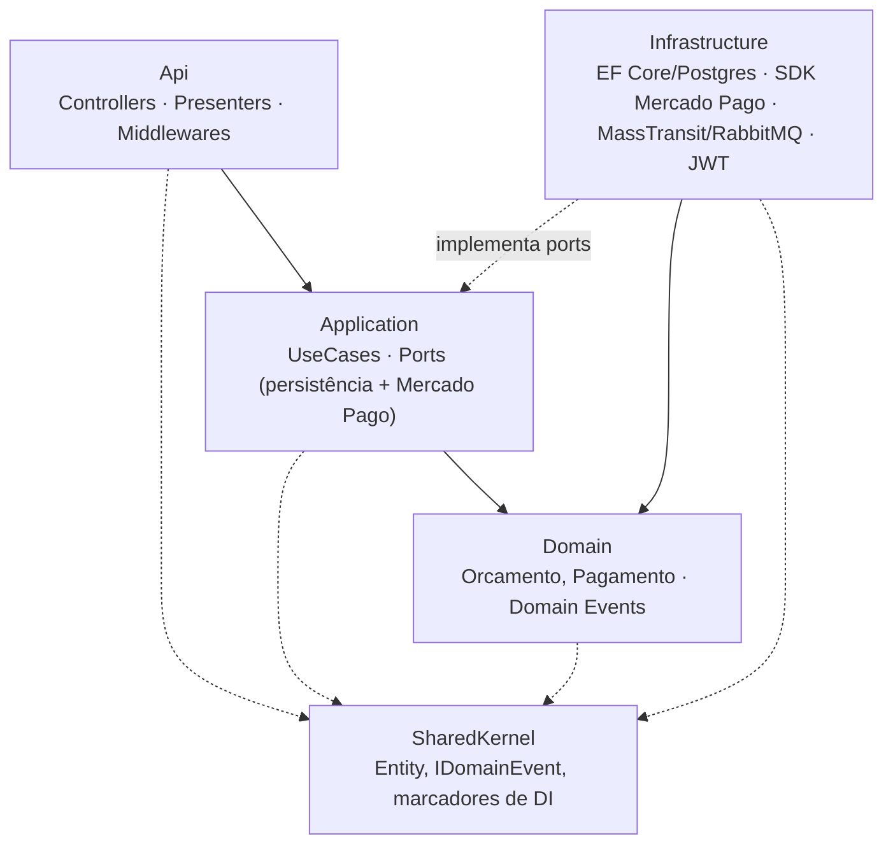
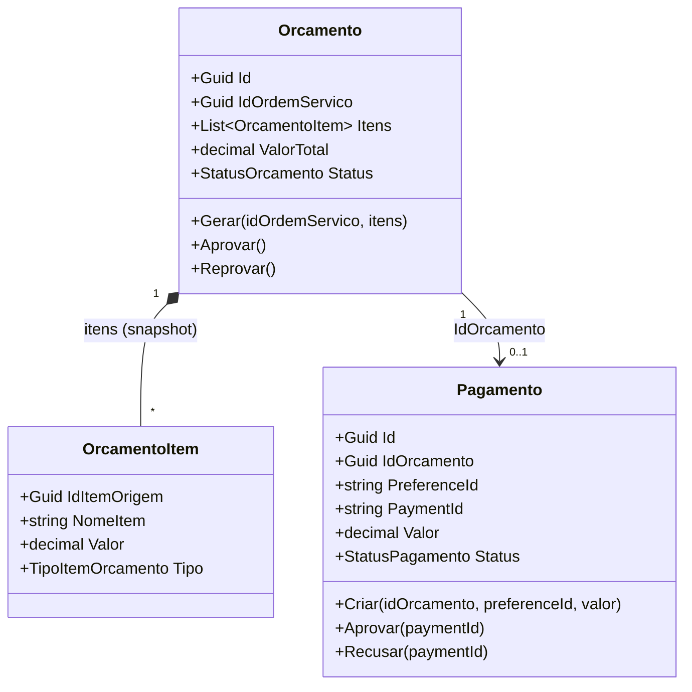
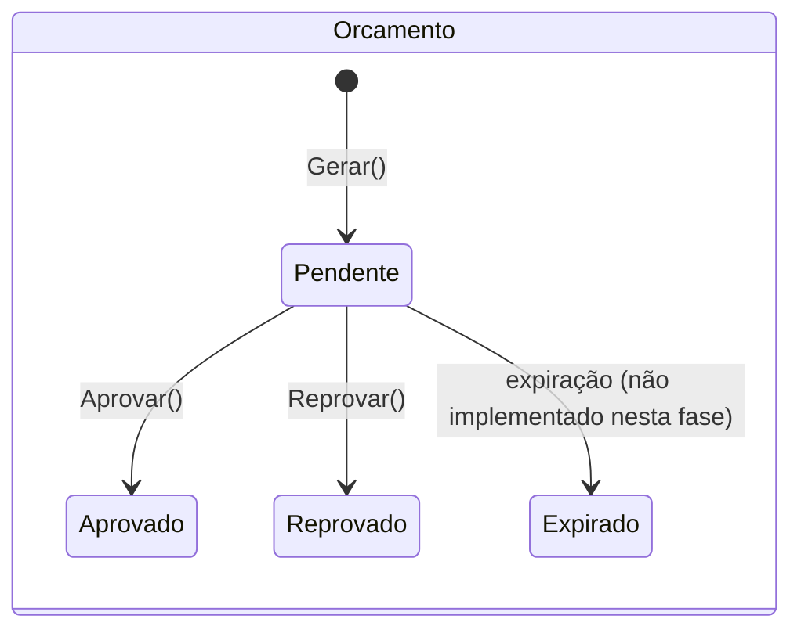
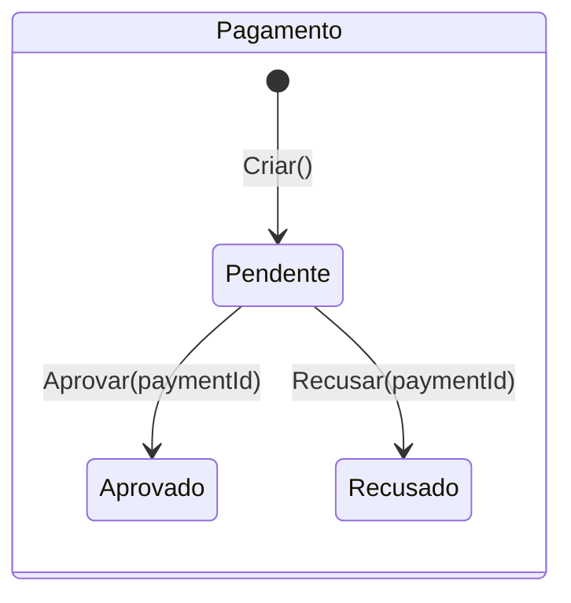
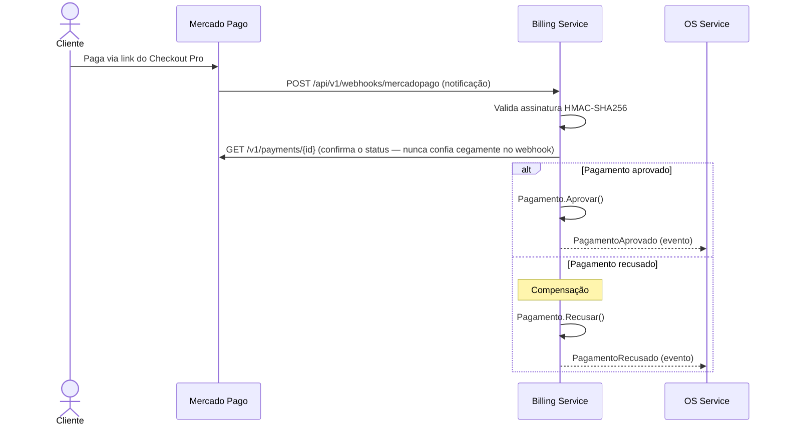

# Arquitetura — Billing Service

Documento complementar ao [README](../README.md), com mais profundidade sobre camadas,
modelo de domínio e a integração com o Mercado Pago. Justificativa do desenho da saga
como um todo (por que a orquestração vive no OS Service): [ADR 0001 no repositório do
OS Service](https://github.com/monnclaro/soat-tech-challenge-os-service/blob/main/docs/adr/0001-saga-orquestrada-sem-state-machine-separado.md).

## Camadas (Clean Architecture)



Regra de dependência garantida por testes de arquitetura (NetArchTest,
`tests/Tests/Camadas`) — `Infrastructure` nunca é referenciada por `Application`/`Domain`.

## Modelo de domínio



`OrcamentoItem` é um **snapshot** (nome/valor/tipo congelados no momento da geração)
— mesmo padrão usado no monolito de origem para `OrdemServicoServico`/`OrdemServicoProduto`:
o orçamento não deve mudar se o catálogo (preço de um serviço, por exemplo) mudar depois.

### Máquinas de estado





## Fluxo — geração de orçamento e pagamento

```mermaid
sequenceDiagram
    participant OS as OS Service
    participant Bill as Billing Service
    participant MP as Mercado Pago

    OS-->>Bill: GerarOrcamento (comando)
    Bill->>Bill: Orcamento.Gerar(itens)

    alt Mercado Pago responde
        Bill->>MP: POST /checkout/preferences
        MP-->>Bill: preference_id + init_point
        Bill->>Bill: Pagamento.Criar(preferenceId)
        Bill-->>OS: OrcamentoGerado (evento)
    else Mercado Pago falha (rede, API fora do ar, credenciais inválidas)
        Note over Bill: Nem toda falha exige compensação: relança pro<br/>MassTransit retentar (UseMessageRetry, 3x/5s) antes<br/>de desistir — cada retentativa chama o use case de<br/>novo, que retoma do Orcamento já persistido
        loop até 3 tentativas
            Bill->>MP: POST /checkout/preferences (retentativa)
        end
        alt Alguma retentativa responde
            MP-->>Bill: preference_id + init_point
            Bill-->>OS: OrcamentoGerado (evento)
        else Todas as retentativas falham
            Note over Bill: Só agora compensa (GerarOrcamentoFaultConsumer,<br/>reage a Fault&lt;GerarOrcamento&gt;)
            Bill-->>OS: OrcamentoFalhou (evento)
        end
    end
```



### Idempotência de `GerarOrcamentoUseCase`

Três ramos, cobertos explicitamente em `GerarOrcamentoUseCaseTests`:

1. **Orçamento não existe** → cria Orcamento + chama Mercado Pago + cria Pagamento + publica `OrcamentoGerado`.
2. **Orçamento existe E Pagamento existe** → reentrega da mensagem já processada, curto-circuita como duplicado (`OrcamentoJaExiste`).
3. **Orçamento existe mas Pagamento não existe** → uma tentativa anterior salvou o Orçamento e falhou antes de concluir a integração com o Mercado Pago; retoma a partir daqui em vez de recriar o Orçamento ou tratar como duplicado.

Se a chamada ao Mercado Pago falhar (incluindo numa retomada do ramo 3), o use case
**não** publica `OrcamentoFalhou` direto — nem toda falha exige compensação. Ele só
sinaliza `Falha` pro output port; quem decide relançar (deixando o MassTransit
retentar) é `GerarOrcamentoConsumer`. Só depois que as retentativas se esgotam é que
`GerarOrcamentoFaultConsumer` publica `OrcamentoFalhou` de fato — ver "Fluxo — geração
de orçamento" acima e a seção de mensageria abaixo.

## Mensageria — comandos e consumers

| Mensagem | Tipo | Direção | Consumer/Handler |
|---|---|---|---|
| `GerarOrcamento` | Comando | OS → Billing | `GerarOrcamentoConsumer` |
| `OrcamentoGerado` | Evento | Billing → OS | — |
| `OrcamentoFalhou` | Evento (compensação) | Billing → OS | — |
| `PagamentoAprovado` | Evento | Billing → OS | — |
| `PagamentoRecusado` | Evento (compensação) | Billing → OS | — |

Publishers em `Infrastructure/Messaging/MassTransitSagaEventPublisher.cs`; contratos
compartilhados (cópia idêntica nos 3 repos) em `Application/Messaging/Contracts/SagaContracts.cs`.

### Retry antes de compensar (`GerarOrcamento`)

Nem toda falha ao processar `GerarOrcamento` exige compensação — se a causa for
transitória (rede, Mercado Pago momentaneamente fora do ar), a mensagem é
retentada automaticamente antes de cancelar a OS:

1. `GerarOrcamentoUseCase` captura a exceção da chamada ao Mercado Pago e sinaliza
   `Falha` no output port, **sem** publicar `OrcamentoFalhou` — o `Orcamento` já
   persistido não é desfeito, fica disponível pra retomada (ver ramo 3 da
   idempotência acima).
2. `GerarOrcamentoConsumer` relança a partir desse sinal, acionando
   `UseMessageRetry` (configurado globalmente em `Infrastructure/DependencyInjection.cs`,
   3 tentativas, 5s de intervalo). Cada retentativa chama o mesmo use case de novo —
   como o `Orcamento` já existe sem `Pagamento`, cai direto no ramo de retomada, sem
   duplicar nada.
3. Só se as 3 tentativas falharem é que o MassTransit publica um `Fault<GerarOrcamento>`,
   consumido por `GerarOrcamentoFaultConsumer` — **só aqui** `OrcamentoFalhou` é
   publicado de fato, compensando a saga (OS Service cancela a OS).

Sem `UseDelayedRedelivery` (plugin do broker não provisionado — ver comentário em
`DependencyInjection.cs`), então as 3 retentativas acontecem em sequência rápida
(5s de intervalo), não com backoff crescente devolvendo a mensagem à fila.

## Persistência

PostgreSQL via EF Core, banco lógico `soat_billing` isolado (ver README > "Banco de
dados"). Migração inicial em `src/Infrastructure/Database/Migrations`.

## Segurança

Nunca emite JWT — valida o Bearer com o mesmo segredo simétrico do OS Service. O
webhook do Mercado Pago (`POST /api/v1/webhooks/mercadopago`) é a única rota
`[AllowAnonymous]`: autentica via assinatura HMAC, não via Bearer.
